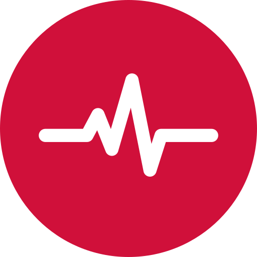
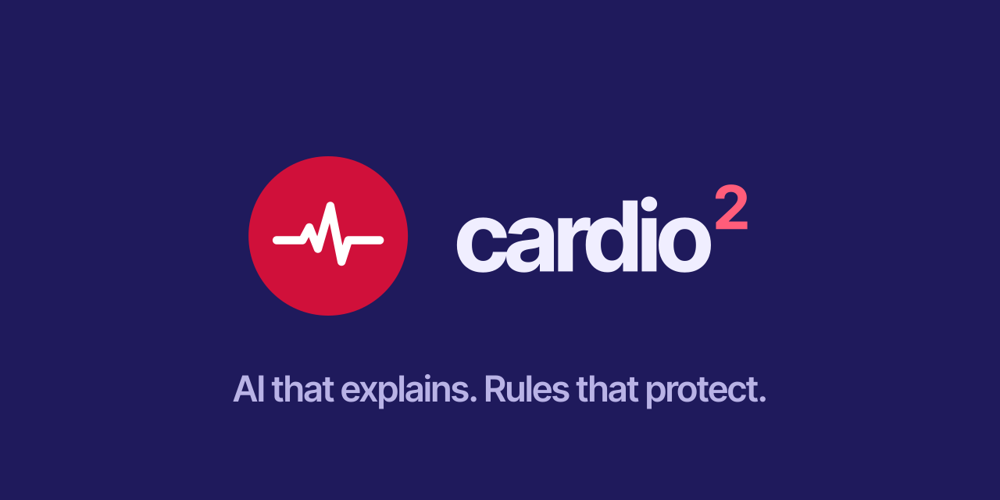

# Cardio2 brand assets

Official Cardio2 logos, colours and images, taken from the [cardio2.info](https://cardio2.info) website.

## Files

| File | Preview | Use it for |
| --- | --- | --- |
| [logo.svg](logo.svg) |  | Main logo on light backgrounds |
| [logo-on-dark.svg](logo-on-dark.svg) |  | Logo on dark backgrounds (indigo or black) |
| [mark.svg](mark.svg) |  | The mark on its own: avatars, app icons, small spaces |
| [favicon.svg](favicon.svg) |  | Browser tab icon |
| [icon-512.png](icon-512.png) |  | App icon and avatar, 512 × 512 |
| [icon-192.png](icon-192.png) |  | App icon, 192 × 192 |
| [social-preview.png](social-preview.png) |  | Link previews and social cards, 1280 × 640 |

The SVG logos have the lettering converted to outlines, so they look the same without the font installed.

## Colours

| Name | Hex | Role |
| --- | --- | --- |
| Artery red | `#D0103A` | Primary accent, the mark |
| Pulse red | `#C30E37` | The superscript 2 on light backgrounds |
| Pulse red, dark | `#FF5D7A` | The superscript 2 on dark backgrounds |
| Vein indigo | `#1F1A5C` | AI and safety sections, dark backgrounds |
| Ink | `#15112A` | Text and the wordmark on light backgrounds |
| Light on indigo | `#F0EEFF` | Text and the wordmark on dark backgrounds |
| Plasma | `#F5F4F8` | Page background |
| White | `#FFFFFF` | The line inside the mark, cards |

## Typography

- Headings and the wordmark: **Inter Tight**, bold (700)
- Body text: **Inter**

Both fonts are by Rasmus Andersson and the Inter project authors, licensed under the [SIL Open Font License 1.1](https://openfontlicense.org). They are not part of the Cardio2 brand licence.

## How to write the name

- Write **Cardio2**: a capital C and the digit 2, with no space.
- In the logo, the name is set in lower case as **cardio²**, with the 2 raised and in red. Use this form only inside the logo itself.
- Do not write "Cardio 2", "CardioTwo" or "CARDIO2".

## Please do not change the logo

- Do not redraw, recolour, stretch, rotate or add effects to the logo.
- Do not change the ECG line inside the mark.
- Leave clear space around the logo.
- Use logo-on-dark.svg on dark backgrounds instead of changing colours yourself.

If you need a format that is not here, email [contact@cardio2.info](mailto:contact@cardio2.info).

## Licence

© 2026 Cardio2. All rights reserved. See [LICENSE](LICENSE).

You may use these files unchanged to refer to Cardio2, for example in articles, partner pages or presentations about Cardio2. Any other use needs our written permission.
